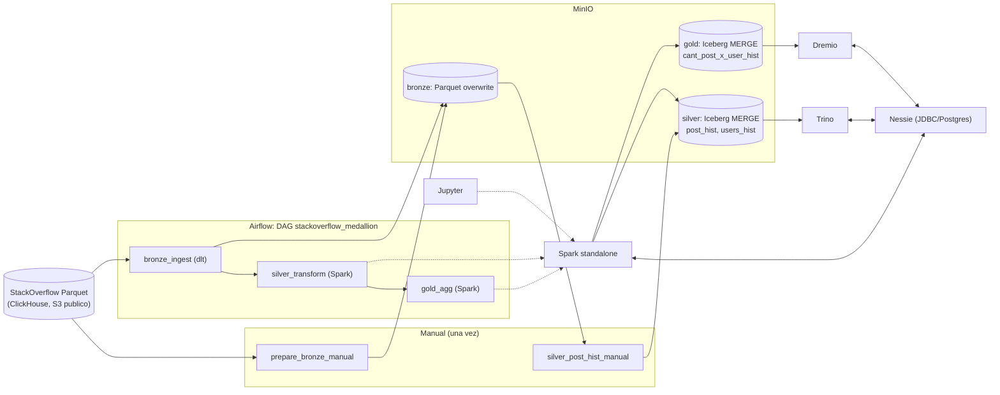

# Proyecto 2 - Frameworks y Herramientas para Big Data - Grupo 2

Integrantes:
- Nicolas Cuarán
- Juan David Daza
- Michel Burgos
- Bryan Carvajal
- Sebastian Belalcazar

---

Pipeline Lakehouse Medallion (Bronze, Silver, Gold) sobre el dataset de StackOverflow de ClickHouse, desplegado con Docker Compose:
**MinIO + Nessie (persistente) + Apache Iceberg + Spark + Airflow + dlt + Jupyter + Trino + Dremio**.

- Tablas: `Posts` y `Users`. Ventana de volumen: **1 de enero a 30 de junio** de 2020 y de 2021, igual en ambas tablas.
- Detalle de la arquitectura y diagrama: [docs/arquitectura.md](docs/arquitectura.md). Diagrama exportado: [docs/arquitectura.svg](docs/arquitectura.svg).



## Arquitectura (resumen)



## Estructura del repositorio

```
docker-compose.yml        # todos los servicios
Dockerfile.airflow        # imagen Airflow/Jupyter (Spark driver + dlt + pyarrow)
Dockerfile.spark          # imagen Spark master/worker (Iceberg + Nessie + S3)
dags/                     # stackoverflow_medallion_dag.py (3 tareas)
jobs/                     # bronze_ingest.py, silver_transform.py, gold_agg.py, common.py
                          # + manuales: prepare_bronze_manual.py, silver_post_hist_manual.py
notebooks/                # mismos scripts como .ipynb (generados con scripts/make_notebooks.py)
sql/                      # consultas Trino/Dremio y validacion
trino/                    # configuracion de Trino y catalogo Iceberg/Nessie
scripts/                  # bootstrap_dremio.py, compare_engines.py, check_counts.py, init de Postgres
docs/arquitectura.md      # arquitectura y diagrama
```

## Requisitos previos

- Docker Desktop (o Docker Engine) con Compose v2, **minimo 16 GB de RAM asignados a Docker** y 6 CPUs recomendados.
- ~25 GB de disco libre. Acceso a Internet (descarga de los Parquet de origen y de las imagenes).
- Una imagen de MinIO disponible localmente. Las imagenes publicas de MinIO responden hoy 401/403 y no se pueden descargar. Por defecto el compose usa `quay.io/minio/minio:RELEASE.2025-09-07T16-13-09Z` y `quay.io/minio/mc:RELEASE.2025-08-13T08-35-41Z`. Para usar otra imagen o un fork, definir `MINIO_IMAGE` y `MINIO_MC_IMAGE` en `.env` (ver Troubleshooting).

## Despliegue paso a paso

```bash
git clone <URL-del-repositorio> && cd Proyecto-2-FHBD-Grupo-2
cp .env.example .env            # opcional (AIRFLOW_UID en Linux: id -u; imagenes de MinIO)
docker compose build
docker compose up -d
docker compose ps               # esperar a que todos esten "healthy"
```

`docker compose up -d` levanta todo, incluido el bootstrap automatico de Dremio (`dremio-init`, contenedor que termina solo). El primer arranque de Dremio y Trino tarda 1-2 minutos.

Si en el equipo `apache/airflow` no se puede descargar pero existe otra imagen Airflow local, definir `AIRFLOW_BASE_IMAGE` en `.env`.

### Preparacion manual de Bronze y Silver (una sola vez, antes del DAG)

El enunciado deja tres archivos de Bronze y la tabla `post_hist` como pasos manuales. Se ejecutan dentro del contenedor de Jupyter (misma imagen y dependencias que Airflow):

```bash
# 1) Bronze: post_2020, post_2021, users_2020 (recorte ene-jun, streaming con pyarrow; 30-70 min segun la red)
docker exec g2_jupyter python /opt/airflow/jobs/prepare_bronze_manual.py

# 2) Silver: post_hist (Spark en el cluster, MERGE INTO)
docker exec g2_jupyter python /opt/airflow/jobs/silver_post_hist_manual.py
```

Tambien se pueden ejecutar como notebooks: `notebooks/prepare_bronze_manual.ipynb` y `notebooks/silver_post_hist_manual.ipynb`.

Resultado en MinIO: `bronze/post/2020/post_2020.parquet`, `bronze/post/2021/post_2021.parquet`, `bronze/users/2020/users_2020.parquet` y la tabla Iceberg `silver.post_hist`.

## Ejecutar el DAG (un solo Play)

1. Abrir Airflow: <http://localhost:8082> (`airflow` / `airflow`).
2. DAG **`stackoverflow_medallion`** -> boton **Trigger DAG** (Play).
3. Tareas encadenadas: `bronze_ingest >> silver_transform >> gold_agg`. Duracion aproximada: 8-30 minutos. Casi todo el tiempo es la tarea de Bronze, que depende de la velocidad de descarga de la fuente.

Por linea de comandos:

```bash
docker exec g2_airflow_scheduler airflow dags trigger stackoverflow_medallion
docker exec g2_airflow_scheduler airflow dags list-runs -d stackoverflow_medallion
```

Los jobs de Spark se ven en el Spark Master UI (<http://localhost:9090>) como aplicaciones `silver_transform` y `gold_agg` ejecutadas en el worker del cluster.

### Idempotencia

Ejecutar el DAG varias veces no crea tablas nuevas ni filas duplicadas: Bronze se reemplaza (dlt `replace`), Silver y Gold usan `CREATE TABLE IF NOT EXISTS` + `MERGE INTO`. Solo cambia la columna `fecha_cargue`. Comprobacion (conteos antes y despues de otra ejecucion):

```bash
docker exec g2_jupyter python /opt/airflow/scripts/check_counts.py
```

Imprime las tablas de `silver` y `gold`, el conteo y la ultima `fecha_cargue` de cada una, y cuantos objetos hay en cada bucket.

## Diseno de Gold

`gold.cant_post_x_user_hist` se construye con un **inner join** entre `post_hist.owner_user_id` y `users_hist.id`, agregado por `(user_id, post_year)`. Como `users_hist` contiene solo usuarios creados en las ventanas ene-jun 2020 y ene-jun 2021 (ventana igual a la de los posts), **los posts de usuarios mas antiguos quedan fuera**. Por eso Gold tiene 386.559 filas aunque `post_hist` tenga 4.170.061 posts. `avg_score` se calcula con aritmetica decimal exacta (`ROUND(CAST(SUM(score) AS DECIMAL(38,6)) / COUNT(score), 2)`) para que Spark y Trino produzcan exactamente el mismo valor.

## Notebooks de respaldo (si Airflow falla)

JupyterLab: <http://localhost:8888> (sin contrasena). Ejecutar en orden `bronze_ingest.ipynb`, `silver_transform.ipynb`, `gold_agg.ipynb` (misma logica que los jobs). Tambien por consola:

```bash
docker exec g2_jupyter jupyter nbconvert --to notebook --execute --inplace /opt/airflow/notebooks/bronze_ingest.ipynb
docker exec g2_jupyter jupyter nbconvert --to notebook --execute --inplace /opt/airflow/notebooks/silver_transform.ipynb
docker exec g2_jupyter jupyter nbconvert --to notebook --execute --inplace /opt/airflow/notebooks/gold_agg.ipynb
```

## Servicios, URLs y credenciales

| Servicio | URL / puerto | Usuario | Contrasena |
| --- | --- | --- | --- |
| MinIO consola | <http://localhost:9001> (API S3: 9000) | `admin` | `password` |
| Airflow | <http://localhost:8082> | `airflow` | `airflow` |
| Jupyter | <http://localhost:8888> | - | - (sin token) |
| Spark Master UI | <http://localhost:9090> (master `spark://localhost:7077`) | - | - |
| Nessie | <http://localhost:19120> (API v1 `/api/v1`, v2 `/api/v2`, UI en `/`) | - | - |
| Trino | <http://localhost:8083> | cualquiera (ej. `admin`) | - |
| Dremio | <http://localhost:9047> (JDBC 31010, Arrow Flight 32010) | `admin` | `Admin12345` |
| PostgreSQL (interno) | solo red Docker, `postgres:5432` | `airflow` / `nessie` | `airflow` / `nessie` |

## Consultas desde Trino y Dremio

**Trino** (catalogo `iceberg`, apuntando a Nessie + MinIO, ver `trino/catalog/iceberg.properties`):

```bash
docker exec -it g2_trino trino --catalog iceberg --schema silver
trino> SHOW TABLES;
```

Archivo [sql/replicate_gold_trino.sql](sql/replicate_gold_trino.sql): reconstruye Gold desde las dos tablas Silver. **Omite `fecha_cargue` a proposito**: esa columna solo registra cuando corrio el pipeline y no es derivable desde Silver.

**Dremio**: fuente `nessie` creada automaticamente por `scripts/bootstrap_dremio.py` (usa la API REST). Archivo [sql/query_gold_dremio.sql](sql/query_gold_dremio.sql): `SELECT * FROM nessie.gold.cant_post_x_user_hist`.

### Conexion desde DBeaver

Si DBeaver corre en otra maquina, reemplazar `localhost` por la IP del equipo donde esta Docker.

**Trino**

1. *Database* -> *New Database Connection* -> **Trino**.
2. Host `localhost`, Port `8083`, Database `iceberg`, Username `admin`, Password vacio. URL equivalente: `jdbc:trino://localhost:8083/iceberg`.
3. *Test Connection* (DBeaver descarga el driver la primera vez) -> *Finish*.
4. En el navegador: `iceberg` -> `silver` -> `post_hist` y `users_hist`.
5. Abrir un editor SQL, pegar [sql/replicate_gold_trino.sql](sql/replicate_gold_trino.sql) y ejecutar. La consulta devuelve 386.559 filas (DBeaver muestra las primeras 200).

**Dremio**

1. *New Database Connection* -> **Dremio**.
2. Host `localhost`, Port `31010`, Username `admin`, Password `Admin12345`. URL equivalente: `jdbc:dremio:direct=localhost:31010`.
3. *Test Connection* -> *Finish*.
4. Ejecutar `SELECT COUNT(*) FROM nessie.gold.cant_post_x_user_hist`. Debe devolver 386.559.

El mismo catalogo tiene un nombre distinto en cada motor: en Trino es `iceberg` (`iceberg.gold...`) y en Dremio es la fuente `nessie` (`nessie.gold...`).

Los archivos de `sql/` con varias consultas (`validate_trino.sql`, `validate_dremio.sql`, `query_gold_dremio.sql`) se ejecutan en DBeaver consulta por consulta (`Ctrl+Enter` con el cursor en cada una, sin seleccionar texto) o completos con *Execute SQL Script* (`Alt+X`).

## Validacion Trino vs. Dremio

Forma rapida, con un solo comando que consulta los dos motores y muestra una tabla comparativa:

```bash
docker exec g2_jupyter python /opt/airflow/scripts/compare_engines.py
```

Imprime, para cada metrica, el valor recalculado en Trino desde Silver, el de Gold leido en Trino y el de Gold leido en Dremio, las filas distintas entre el recalculo y Gold (deben ser 0) y la ultima `fecha_cargue`. Termina con `RESULTADO: LAS TABLAS SON IGUALES`.

Paso a paso, motor por motor:

1. En Trino: `docker exec g2_trino trino --file /opt/sql/validate_trino.sql`, o pegar el contenido de `sql/validate_trino.sql` en DBeaver. Calcula conteo y checksums de la replica desde Silver y de Gold leida por Trino, y ejecuta `replica EXCEPT gold` y `gold EXCEPT replica` (ambos deben dar 0 filas).
2. En Dremio: ejecutar `sql/validate_dremio.sql` en el SQL Runner (<http://localhost:9047>) o con `docker exec g2_jupyter python /opt/airflow/scripts/run_dremio_sql.py /opt/airflow/sql/validate_dremio.sql`.
3. Los valores deben ser identicos.

Resultado obtenido (ejecucion del 2026-10-12):

| Metrica | Trino (replica desde Silver) | Trino (Gold) | Dremio (Gold) |
| --- | --- | --- | --- |
| row_count | 386559 | 386559 | 386559 |
| sum_user_id | 5488733547675 | 5488733547675 | 5488733547675 |
| sum_questions | 524697 | 524697 | 524697 |
| sum_answers | 302023 | 302023 | 302023 |
| sum_total_posts | 826803 | 826803 | 826803 |
| sum_total_score | 605282 | 605282 | 605282 |
| sum_avg_score_x100 | 27505836 | 27505836 | 27505836 |

`replica EXCEPT gold` = 0 filas y `gold EXCEPT replica` = 0 filas. Las 20 primeras filas por `(user_id, post_year)` coinciden en Trino y Dremio.

## Nessie persistente

El version store de Nessie usa JDBC sobre PostgreSQL (volumen `postgres-data`). Prueba:

```bash
docker compose restart nessie
docker exec g2_jupyter python /opt/airflow/scripts/check_counts.py
```

Las tablas siguen registradas tras el reinicio (incluso tras `docker compose down` + `up`, mientras no se use `down -v`).

## Troubleshooting

- **Imagenes sin acceso a registros (fallback con `docker save` / `docker load`)**: en una maquina donde las imagenes ya existen:
  ```bash
  docker save -o lakehouse-images.tar quay.io/minio/minio:RELEASE.2025-09-07T16-13-09Z quay.io/minio/mc:RELEASE.2025-08-13T08-35-41Z \
    ghcr.io/projectnessie/nessie:0.77.1 trinodb/trino:476 dremio/dremio-oss:26.0.5 postgres:16 fhbd/spark-iceberg:3.5.5
  ```
  y en la maquina destino: `docker load -i lakehouse-images.tar`. Luego `docker compose build airflow-init` (usa `AIRFLOW_BASE_IMAGE` si `apache/airflow` no se puede descargar).
- **MinIO responde 401/403 o no se puede descargar la imagen**: MinIO dejo de publicar imagenes comunitarias. Opciones:
  - Si la imagen por defecto ya existe localmente (`docker images | grep minio`), no hay que hacer nada.
  - Copiarla desde otra maquina con `docker save` / `docker load`.
  - Usar otra imagen o fork compatible definiendo `MINIO_IMAGE` y `MINIO_MC_IMAGE` en `.env`.
- **Bronze solo contiene archivos de datos**: dlt escribe tablas de estado (`_dlt_loads`, `_dlt_version`, `_dlt_pipeline_state`, `init`) junto a los datos; `bronze_ingest` las elimina al terminar porque no son necesarias para cargas `replace`.
- **El job de Spark no obtiene recursos**: verificar que no haya otra aplicacion ocupando el worker (Spark UI -> Running Applications); cerrar sesiones de Jupyter con `spark.stop()`.
- **Falta una tabla Silver al correr `gold_agg`**: ejecutar antes la preparacion manual.
- **Reiniciar desde cero**: `docker compose down -v` (borra datos de MinIO, Postgres/Nessie y Dremio).
