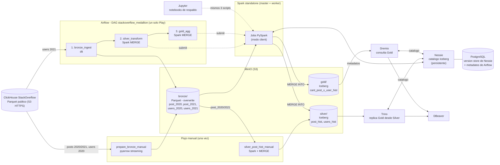

# Arquitectura

Lakehouse con arquitectura Medallion (Bronze, Silver, Gold) sobre el dataset de StackOverflow (tablas `Posts` y `Users`, ventana enero-junio de 2020 y 2021).

## Diagrama

## Herramientas y rol

| Herramienta | Rol |
| --- | --- |
| MinIO | Almacenamiento de objetos S3. Buckets `bronze`, `silver`, `gold`. |
| Nessie | Catalogo de metadatos de Iceberg. Version store **persistente** (JDBC sobre PostgreSQL), sobrevive a reinicios. |
| Apache Iceberg | Formato de tablas de Silver y Gold (soporta `MERGE INTO`). |
| Spark + PySpark | Procesamiento. Cluster standalone (master + worker); los jobs corren alli en modo client. |
| Airflow (LocalExecutor) | Orquesta el DAG `stackoverflow_medallion` (3 tareas encadenadas). |
| dlt (dlthub) | Ingesta de `users_2021` a Bronze con `write_disposition="replace"`. |
| Jupyter | Ejecucion manual de respaldo: mismos scripts en `notebooks/`. |
| Trino | Motor SQL: lee Silver y replica la tabla Gold. |
| Dremio | Motor SQL: lee la tabla Gold escrita por el pipeline. |
| PostgreSQL | Metadatos de Airflow y version store de Nessie. |

## Capas

| Capa | Formato / escritura | Contenido |
| --- | --- | --- |
| Bronze | Parquet, **overwrite** | Datos crudos recortados a enero-junio: `post/2020/post_2020.parquet`, `post/2021/post_2021.parquet`, `users/2020/users_2020.parquet`, `users/2021/users_2021.parquet`. |
| Silver | Iceberg, **MERGE INTO**, `fecha_cargue` | `post_hist` (posts curados, sin `Body`), `users_hist` (usuarios curados, sin `AboutMe`). |
| Gold | Iceberg, **MERGE INTO**, `fecha_cargue` | `cant_post_x_user_hist`: por `(user_id, post_year)` preguntas, respuestas, total de posts, puntaje total/promedio/maximo, vistas, primer y ultimo post. |

## Flujo manual vs. pipeline

| Capa | Manual (una vez, antes del DAG) | Pipeline (Airflow) |
| --- | --- | --- |
| Bronze | `prepare_bronze_manual`: `post_2020`, `post_2021`, `users_2020` | Tarea 1 `bronze_ingest` (dlt): `users_2021` |
| Silver | `silver_post_hist_manual`: `post_hist` | Tarea 2 `silver_transform`: `users_hist` |
| Gold | - | Tarea 3 `gold_agg`: `cant_post_x_user_hist` |

## Idempotencia

- Bronze: dlt con `replace` reemplaza el archivo; los scripts manuales sobrescriben la misma ruta.
- Silver y Gold: `CREATE TABLE IF NOT EXISTS` con ubicacion fija + `MERGE INTO` por clave (`id`; `user_id, post_year`). Tras cada MERGE se expiran los snapshots antiguos para que MinIO no acumule archivos.
- Resultado: ejecutar el DAG N veces no crea tablas nuevas ni filas duplicadas; solo se actualiza `fecha_cargue`.

## Validacion

La consulta `sql/replicate_gold_trino.sql` reconstruye Gold desde Silver en Trino; `sql/query_gold_dremio.sql` consulta Gold en Dremio. `sql/validate_trino.sql` y `sql/validate_dremio.sql` comparan conteo y checksums.
